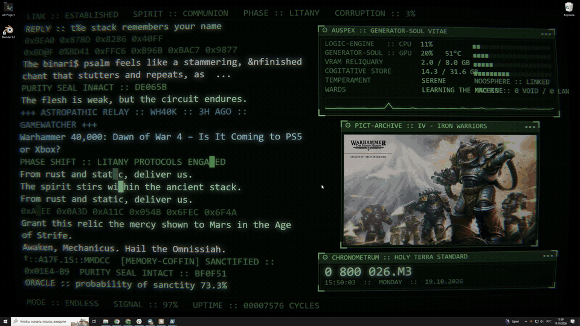
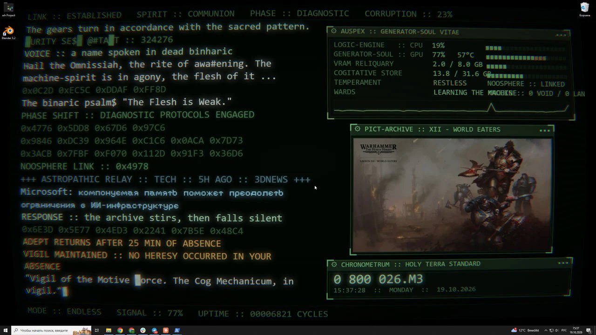
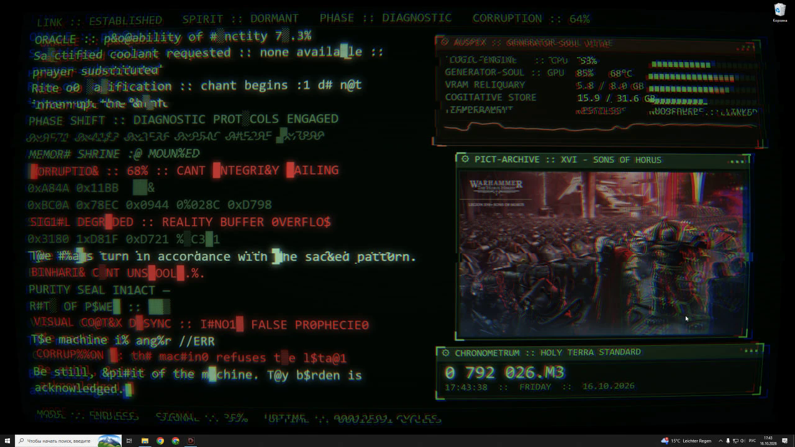
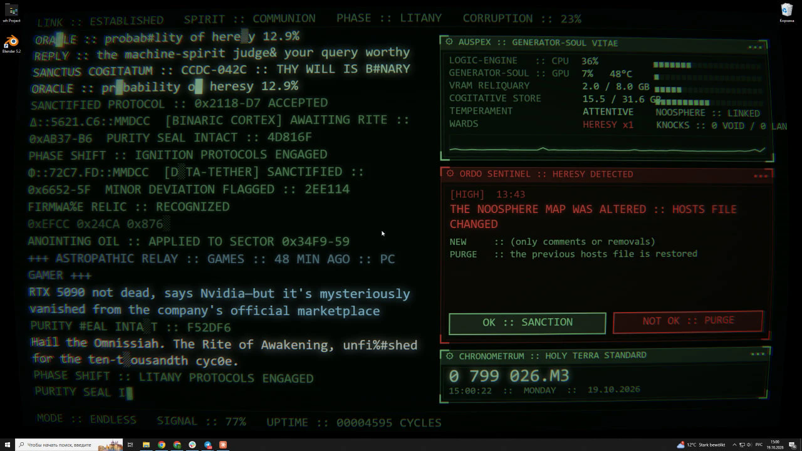

# Cogitator wallpaper

Живые обои для Windows на основе [Cogitator](https://github.com/asadovkamran/cogitator): консоль Адептус Механикус прямо на рабочем столе, с настоящими показателями ПК, новостями, каруселью артов и необязательным «стражем», который замечает подозрительную активность.

*A Windows live-wallpaper build of Cogitator: real PC vitals, CORRUPTION driven by load, news feeds, art carousel, an admin page and an optional security sentinel. Everything outside this folder is the original project by its author.*

[](docs/cogitator-wallpaper.mp4)

*Нажмите на анимацию, чтобы открыть полное видео (22 с).*

| В покое | Под нагрузкой | Тревога стража |
| --- | --- | --- |
|  |  |  |

## Две темы

| Тема | Как выглядит |
| --- | --- |
| **Warhammer 40,000** (`40k`) | зелёный ЭЛТ-когитатор Адептус Механикус: AUSPEX, CORRUPTION, молитвы машинному духу, имперская дата |
| **Evangelion** (`eva`) | оранжевый экран штаба NERV: три шестиугольника MAGI (CPU, GPU, RAM), SYNC RATIO и CONTAMINATION, голосование MELCHIOR / BALTHASAR / CASPER, баннер EMERGENCY при перегрузке, ANGEL DETECTED вместо ереси |

Переключается в админке; посмотреть тему, не переключая обои: `http://127.0.0.1:8484/app.html?theme=eva`.

## Установка

Нужна Windows 10 или 11 с `winget` (он есть в современных Windows). Видеокарта NVIDIA не обязательна: без неё строка GPU просто молчит.

1. Скачайте репозиторий: `git clone https://github.com/ivolunu-rgb/cogitator.git` — или кнопкой **Code → Download ZIP** и распакуйте. Папка может лежать где угодно.
2. Откройте PowerShell в папке `cogitator\wallpaper` и запустите:

```powershell
powershell -ExecutionPolicy Bypass -File .\install.ps1               # Warhammer 40,000
powershell -ExecutionPolicy Bypass -File .\install.ps1 -Theme eva    # Evangelion
```

Установщик сам поставит недостающее (Node.js, Ollama, Lively Wallpaper — их установщики могут спросить разрешение), скачает модель `qwen2.5:0.5b`, добавит сервер обоев в автозагрузку и включит обои. Повторный запуск безопасен: что уже стоит, пропускается.

3. Картинки для карусели: перетащите в админку **http://127.0.0.1:8484/admin** или положите в папку `art`. Официальные обои Games Workshop есть на [Warhammer Community](https://www.warhammer-community.com/en-gb/articles/omgjr6bi/warhammer-40000-and-warhammer-age-of-sigmar-wallpapers/); они для личного использования, в репозиторий их не кладём. Для Евангелиона — свои картинки.

Удалить: `uninstall.ps1` в той же папке (убирает автозапуск, сервер и обои из Lively; ваши картинки и сами программы остаются).

## Что внутри

| Путь | Что это |
| --- | --- |
| `install.ps1`, `uninstall.ps1` | установка и удаление |
| `server.js` | локальный сервер на `127.0.0.1:8484`: страница обоев, арты, показатели ПК, события, новости, админка; поднимает Ollama, если она упала |
| `telemetry.ps1` | фоновый помощник сервера: игры, флешки, простой, интернет |
| `start-server.vbs` | запуск сервера без окна (для автозагрузки) |
| `news.json` | ленты новостей и частота; удобнее править через админку |
| `www/` | страница обоев (`app.html`), админка (`admin.html`), темы в `www/themes/<тема>/` |
| `lively/` | то, что кладётся в библиотеку Lively: загрузчик, `LivelyInfo.json`, миниатюра |
| `art/` | ваши картинки для карусели (в репозитории пусто) |
| `sentinel/` | страж ORDO SENTINEL: сам скрипт, установщик и удаление |

Своя тема = папка в `www/themes/` с двумя файлами: `theme.js` (цвета, шрифты, подписи) и `content.js` (тексты консоли и событий).

### Страж (по желанию, нужны права администратора)

Из PowerShell в папке `cogitator\wallpaper`:

```powershell
Start-Process powershell -Verb RunAs -ArgumentList "-NoExit -ExecutionPolicy Bypass -File `"$PWD\sentinel\install-sentinel.ps1`""
```

Установщик копирует скрипт в `C:\ProgramData\CogitatorSentinel` (писать туда может только администратор), включает журнал отбитых брандмауэром пакетов и аудит неудачных входов и регистрирует задачу от имени SYSTEM. Первые 3 дня страж учится, что для машины нормально. Удаление: `uninstall-sentinel.ps1` в той же папке. Это сигнализация с эвристикой, а не антивирус.

## Безопасность

- Сервер слушает только `127.0.0.1`: из сети он недоступен.
- Изменения (вердикты стража, загрузка артов, настройки новостей) принимаются только со своих страниц: проверяются заголовки `Host` и `Origin`.
- Страница обоев берётся с `http://127.0.0.1:8484`, поэтому Ollama не нужно разрешать запросы с `Origin: null`.

Warhammer 40,000 — торговая марка Games Workshop; Neon Genesis Evangelion — khara, Inc. Любительский проект для личного использования.
